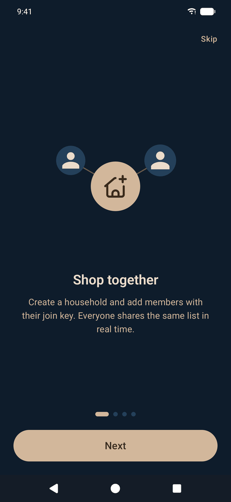
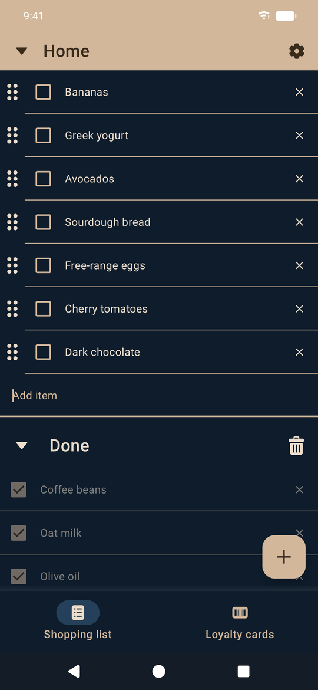
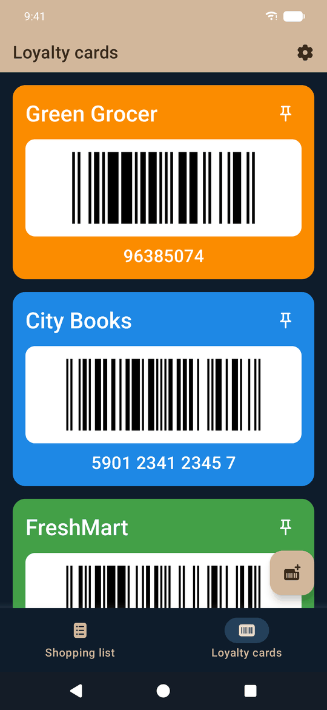
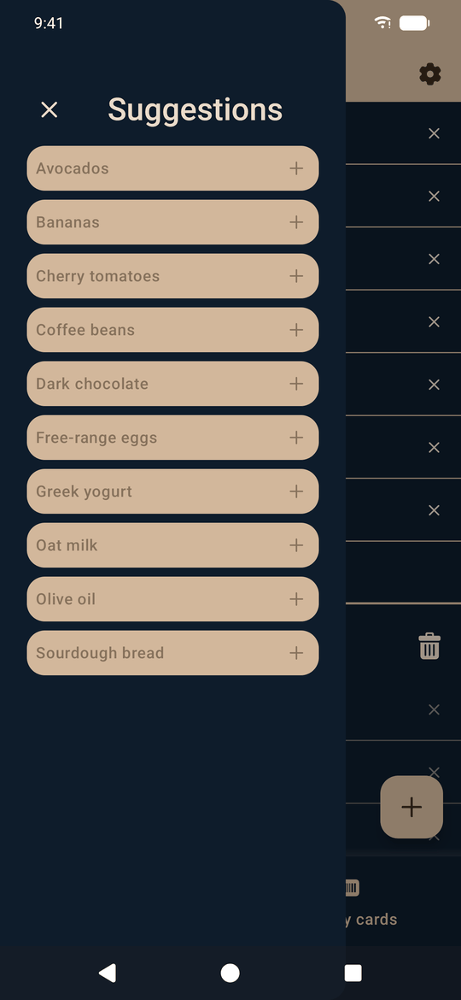
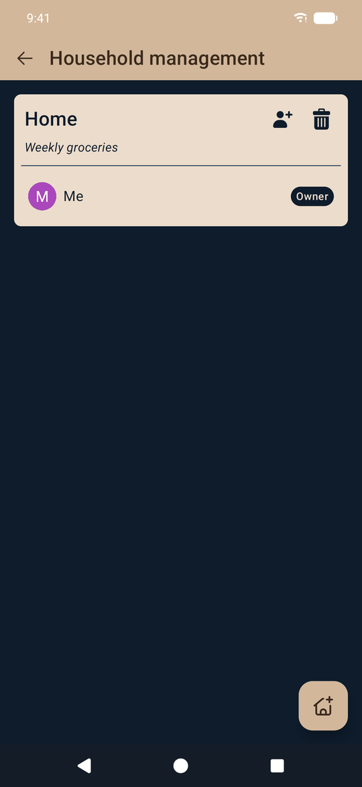
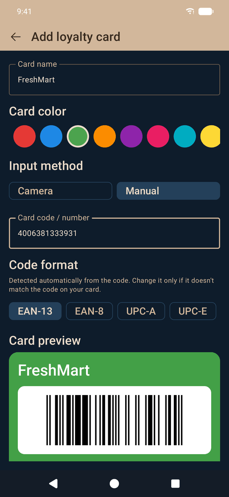
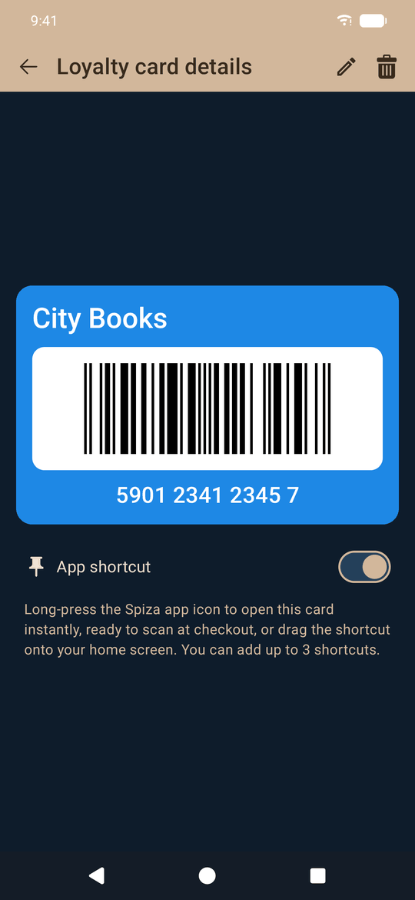
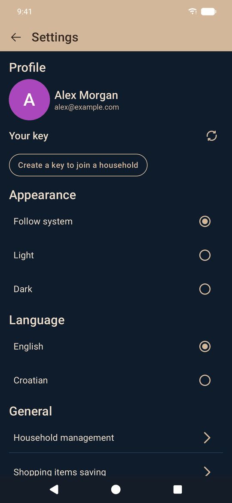
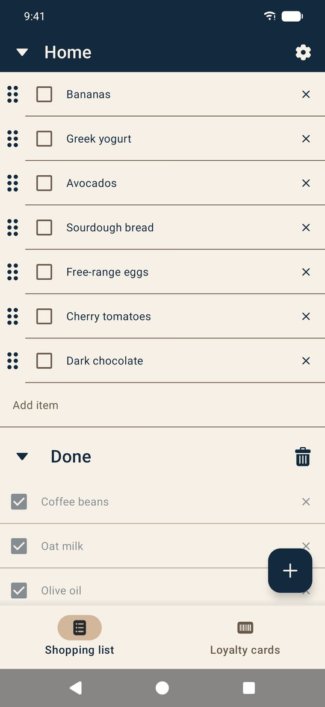

# Spiza

**Shared shopping lists for your whole household.**

Spiza is a shopping-list app for Android and iOS. Members of a household share one list in real time, the app remembers
what you often buy, and your loyalty cards are always one tap away at checkout. It is built with
**Kotlin Multiplatform** and **Compose Multiplatform** — almost all code, including the UI, is shared between platforms.

<p align="center">
  
  &nbsp;
  
  &nbsp;
  
  &nbsp;
  
</p>

## Features

### Households
- Create up to 3 households (name + optional description) and switch between them.
- Every user has a personal **join key**; the household owner adds members by entering it (up to 10 members per household).
- Owners can edit or delete the household and remove members; members can leave.

### Shopping list
- Real-time list shared by all household members, synced through Firestore and usable offline.
- Add, edit, check off and drag to reorder items (up to 100 per household).
- Checked items move to a collapsible *Done* section and can be cleared in one go.

### Suggestions
- With *shopping items saving* enabled, Spiza remembers items you add and offers them as suggestions next time.
- Manage saved suggestions in settings: sort (alphabetically, by last use or by frequency), add, delete one or all.
- Stored locally on the device.

### Loyalty cards
- Add cards by **scanning with the camera**, **loading a screenshot from the gallery**, or typing the number manually.
- Barcode format is detected automatically and validated (EAN, UPC, Code 128, ITF, Codabar, QR, Aztec, …).
- Pick a card colour, then show the barcode full-screen at checkout.
- Pin up to 3 cards as **app shortcuts** (long-press the app icon) to open them instantly.
- Stored locally on the device.

### App
- Sign in with Google.
- Onboarding that introduces the main features.
- Light / dark / system theme, English and Croatian language.
- Forced and recommended app updates driven by Firebase Remote Config.
- Account deletion that removes all remote data in a single atomic batch.
- Friendly error, offline and empty states everywhere; errors are reported to Crashlytics.

## Screenshots

<table>
  <tr>
    <th>Shopping list</th>
    <th>Suggestions</th>
    <th>Household management</th>
  </tr>
  <tr>
    <td></td>
    <td></td>
    <td></td>
  </tr>
  <tr>
    <th>Loyalty cards</th>
    <th>Add a loyalty card</th>
    <th>Card details &amp; app shortcut</th>
  </tr>
  <tr>
    <td></td>
    <td></td>
    <td></td>
  </tr>
  <tr>
    <th>Onboarding</th>
    <th>Settings</th>
    <th>Light theme</th>
  </tr>
  <tr>
    <td></td>
    <td></td>
    <td></td>
  </tr>
</table>

## Tech stack

| Area | Technology |
|---|---|
| Language | Kotlin 2.4 (Multiplatform), Swift for iOS Firebase bridges |
| UI | Compose Multiplatform, Material 3, Compottie (Lottie animations), Coil 3 |
| Navigation | Navigation 3 with type-safe `@Serializable` routes |
| Architecture | Clean Architecture + MVVM (AndroidX Lifecycle ViewModel, `StateFlow`) |
| DI | Koin |
| Async | Kotlin Coroutines & Flow |
| Remote data | Firebase Auth, Cloud Firestore, Remote Config, Crashlytics |
| Local data | Room (KMP) with bundled SQLite, Multiplatform Settings |
| Auth | Google Sign-In via Android Credential Manager / Firebase Auth on iOS |
| Camera & barcodes | CameraX + ML Kit (Android), AVFoundation (iOS), ZXing for rendering, Moko Permissions |
| Logging | Kermit, Firebase Crashlytics |
| Testing | kotlin-test, AssertK, Turbine, Room in-memory DB, Firestore emulator (rules tests), Kover |
| Code style | ktlint |

Targets: Android (minSdk 24, targetSdk 37) and iOS 18.2+.

## Architecture

```
Screen (stateless composable)
   ↑ state: StateFlow   ↓ Callbacks
ViewModel ──► UseCase ──► Repository (interface in domain, impl in data)
                              │
                              ├─► DataSource ─► Firestore (Android) / Swift bridge (iOS)
                              └─► Room DAO / Settings
```

- **Layers:** `ui → domain ← data`. The domain layer is pure Kotlin (no Compose, Firebase, Room or Koin).
- **Use cases** hold business rules (trimming, ordering, limits via `ConstraintsManager`); ViewModels only talk to use cases.
- **Screens** are stateless; `AppNavigation` wires each screen to its ViewModel, state and callbacks.
- **Platform code:** Firebase on Android is called directly from Kotlin; on iOS it lives in Swift (`Swift*Bridge.swift`)
  behind Kotlin `Ios*Bridge` interfaces, so both platforms share the same repositories and data-source contracts.
- **Error handling:** every ViewModel action goes through `launchSafely`, every stream through `catchAndRecord`;
  failures are classified (`Offline`, `PermissionDenied`, `NotFound`, …) and shown as localized states, never crashes.
- **Security:** `firestore.rules` is the source of truth for who may read/write households, items, users and join keys,
  and is covered by emulator tests in `firestore-tests/`.

### Project structure

```
androidApp/          Android entry point (MainActivity, Application, resources)
iosApp/              iOS entry point + Swift Firebase bridges
shared/src/
  commonMain/        shared code: data, domain, ui, navigation, DI, resources (EN + HR strings)
  androidMain/       Android implementations (Firestore, Credential Manager, CameraX, shortcuts)
  iosMain/           iOS implementations (bridge wrappers, camera, shortcuts)
  commonTest/        unit tests (JVM + iOS)
  databaseTest/      Room repository and migration tests on a real database
shared/schemas/      exported Room schemas
firestore.rules      Firestore security rules
firestore-tests/     security rules tests (Node + Firestore emulator)
docs/                testing and release handbooks
```

## Getting started

Requirements: JDK 17+, Android Studio, Xcode (for iOS). Firebase config files
(`androidApp/google-services.json`, `iosApp/iosApp/GoogleService-Info.plist`) are required to build.

| What | Command |
|---|---|
| Android debug build | `./gradlew :androidApp:assembleDebug` |
| iOS app | open `iosApp/` in Xcode and run |
| Unit tests (JVM) | `./gradlew :shared:testAndroidHostTest` |
| Unit + Room tests (iOS simulator) | `./gradlew :shared:iosSimulatorArm64Test` |
| Coverage report | `./gradlew :shared:koverHtmlReport` |
| Lint | `./gradlew ktlintCheck` / `./gradlew ktlintFormat` |
| Firestore rules tests | `cd firestore-tests && npm test` |

## Documentation

- [docs/TESTING.md](docs/TESTING.md) — testing levels, structure and recipes
- [docs/RELEASE.md](docs/RELEASE.md) — release checklists for Android and iOS, forcing app updates

## Credits

Login screen photo: [Smiley woman using organic bag for veggies](https://www.magnific.com/free-photo/smiley-woman-using-organic-bag-veggies_9877793.htm) — Designed by [Magnific](https://www.magnific.com), used under the Magnific free license.
